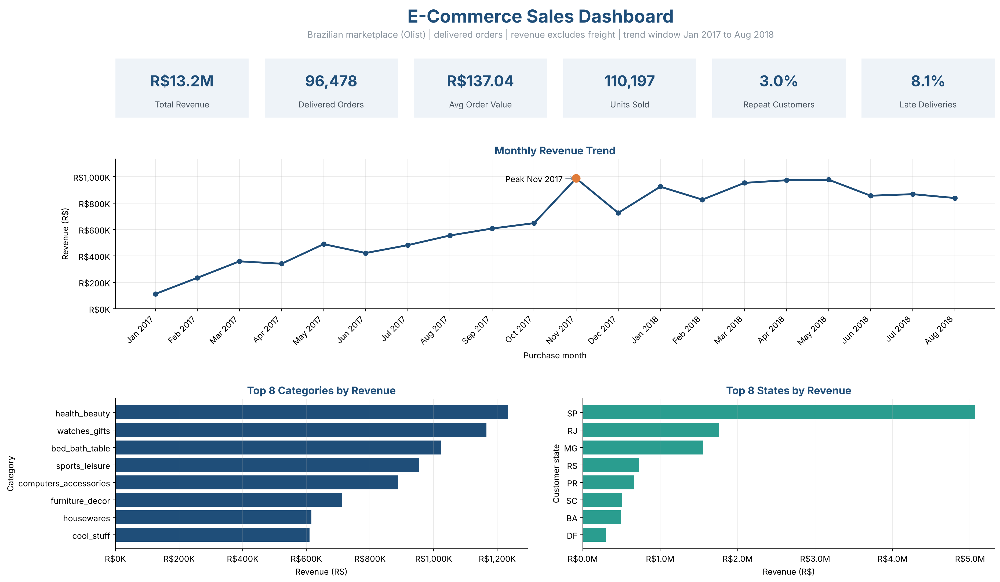
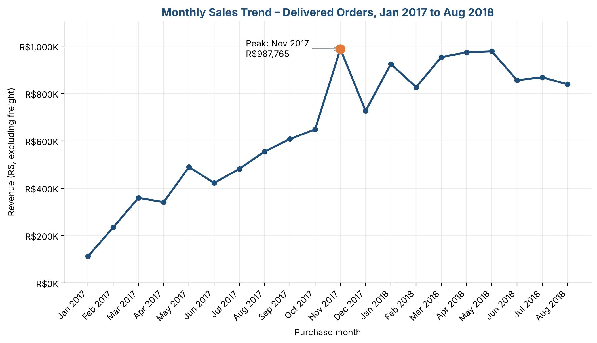

# Brazilian E-Commerce Sales Analysis

## Week 1 – Data Science Internship, WeIntern Pvt Ltd

**Week:** 1 of the Data Science Internship
**Objective:** Build disciplined habits in data cleaning, structured analysis, visualization and reporting by cleaning the Olist Brazilian e-commerce dataset, calculating business KPIs, analysing sales and customer behaviour, and presenting the results through charts, a dashboard mockup and a written report.



## Dataset Description

Public **Olist Brazilian E-Commerce Dataset** ([Kaggle](https://www.kaggle.com/datasets/olistbr/brazilian-ecommerce)): about 100,000 orders placed on a Brazilian marketplace between 2016 and 2018.

Eight tables are used: customers, orders, order items, payments, reviews, products, sellers and the category translation. The geolocation table is not needed for the required analysis and is not included.

Notes on the data:
- There is no quantity column. Each order item row is one unit.
- Product names are hidden, so products are identified by ID and category.
- Dates are stored as text in the raw files and are converted during cleaning.

## Tools and Libraries

Python, Pandas, NumPy, Matplotlib, Jupyter Notebook, Git and GitHub.

## Key Steps Performed

1. **Inspection:** loaded all tables, classified every column (identifier, numeric, categorical, date, text) and recorded sizes.
2. **Missing values:** measured gaps column by column and chose a documented strategy for each (keep and flag, fill with a label, fill with the median).
3. **Duplicates:** checked full-row duplicates and repeated IDs. No accidental duplicates were found, so nothing was removed.
4. **Validation:** 27 rules tested (18 with zero violations) covering prices, payment values, review scores, date formats and order, standardized values, and links between tables.
5. **Cleaning:** converted dates, standardized text, fixed column names, translated two missing category names, and saved cleaned files separately. Raw data is untouched.
6. **KPIs:** revenue, orders, average order value, units, top category and top product, calculated on delivered orders and verified against the raw files.
7. **Analysis:** monthly trend, category trend, regions, customer segments, delivery performance and payments.
8. **Visualization:** 6 bar charts, 2 line charts, 1 pie chart and a dashboard mockup, each with a title, labelled axes and a written finding.
9. **Reporting:** a 10-section PDF report with findings, recommendations and limitations.

## KPI Summary (delivered orders, freight excluded)

| KPI | Value |
| --- | --- |
| Total Revenue | R$13,221,498.11 |
| Total Orders | 96,478 |
| Average Order Value | R$137.04 |
| Total Units Sold | 110,197 |
| Top-Selling Category (units) | bed_bath_table (10,953) |
| Top Revenue Category | health_beauty (R$1,233,132) |
| Top Revenue-Generating Product | `bb50f2e236e5eea0100680137654686c` (health_beauty, R$63,560) |

Revenue is the sum of item price for orders with status `delivered`. Freight is excluded.

## Major Findings

1. **Overall performance:** Delivered orders generated R$13,221,498 from 96,478 orders, an average order value of R$137.04, and delivered orders hold 97.3% of the product value of all orders (the rest is canceled, unavailable or still in progress).
2. **Growth with a one-off spike:** Monthly revenue rose 650% from Jan 2017 to Aug 2018. Nov 2017 was the peak month (+52% on Oct 2017), with 1,176 orders on 24 Nov 2017 alone (6.1x a typical November day), and December fell 26% below the peak.
3. **Category concentration:** health_beauty leads revenue (R$1,233,132) while bed_bath_table leads units (10,953). The top 10 categories provide 62.4% of revenue.
4. **Weak customer retention:** Only 3.00% of 93,358 customers ordered more than once, yet they produce 5.51% of revenue (R$260 per repeat customer versus R$138 for one-time customers).
5. **Skewed customer value:** The top 10% of customers generate 41.1% of revenue.
6. **Geographic concentration:** SP contributes 38.3% of revenue and the top three states 63.4%. Sao Paulo holds 15.6% of orders. High-value orders (R$269 and above) follow order volume rather than clustering in one city: Sao Paulo has 13.5% of them against 15.6% of all orders.
7. **Delivery quality:** Average delivery takes 12.6 days and 8.11% of orders arrive after the estimated date; MA is the worst state at 19.7%. Late orders score 2.57 in reviews against 4.29 for on-time orders.
8. **Payments and cancellations:** Credit Card makes up 78.5% of payment value and 67% of card payments use installments. 1.24% of orders were canceled or unavailable (R$97,243 of product value).

## Recommendations

- **Launch retention campaigns (finding: weak retention):** Target one-time buyers with follow-up offers after delivery, because each repeat customer is worth R$260 against R$138 for a one-time customer.
- **Prepare capacity for promotional peaks (finding: growth with a one-off spike):** Plan stock and logistics ahead of November campaigns and keep the post-peak decline in mind when forecasting.
- **Fix delivery in the weakest states first (finding: delivery quality):** Review carrier performance and delivery estimates in MA and the other high-late states; set more realistic estimates where lateness is structural.
- **Balance marketing and inventory by category (finding: category concentration):** Spend marketing budget on health_beauty and similar high-revenue categories, and base stock decisions on units sold.
- **Keep installment options visible at checkout (finding: payments):** Because most value is paid by card and many payments use installments, make installment choices prominent.
- **Investigate cancellations by month and seller (finding: payments and cancellations):** Find out whether unavailable stock or seller behaviour drives cancellations, since each one is lost revenue.

## Visual Outputs

| Chart | File |
| --- | --- |
| Monthly sales trend (line) | `outputs/charts/monthly-sales-trend.png` |
| Top 5 category revenue trend (line) | `outputs/charts/category-revenue-trend.png` |
| Revenue by category (bar) | `outputs/charts/revenue-by-category.png` |
| Top 10 products by units (bar) | `outputs/charts/top-10-products-by-units.png` |
| Orders by city (bar) | `outputs/charts/orders-by-city.png` |
| Orders by delivery status (bar) | `outputs/charts/delivery-status-counts.png` |
| Revenue by state (bar) | `outputs/charts/revenue-by-state.png` |
| Late delivery rate by state (bar) | `outputs/charts/late-delivery-by-state.png` |
| Payment mode share (pie) | `outputs/charts/payment-mode-share.png` |
| Dashboard mockup | `outputs/dashboard/dashboard-mockup.png` |



## Folder Structure

```
data-science-week1-assignment/
├── data/
│   ├── raw/          # original Olist files (unchanged)
│   └── cleaned/      # cleaned tables and final_sales_dataset.csv
├── notebooks/
│   └── week1_analysis.ipynb
├── outputs/
│   ├── charts/       # all charts
│   ├── dashboard/    # dashboard mockup
│   └── reports/      # missing values, validation, cleaning decisions, KPI tables
├── reports/
│   └── final_report.pdf
├── screenshots/      # key outputs (dataset overview, missing values, KPIs, trend, dashboard)
├── README.md
└── requirements.txt
```

## How to Run

1. Clone or download this repository.
2. (Optional) create a virtual environment: `python -m venv .venv` and activate it.
3. Install the libraries:
   ```
   pip install -r requirements.txt
   ```
4. Start Jupyter and open the notebook:
   ```
   jupyter notebook notebooks/week1_analysis.ipynb
   ```
5. Run all cells from top to bottom. The notebook finds the project folder by itself, reads `data/raw/`, and rewrites the cleaned data, charts and report tables.

The raw files must stay in `data/raw/` with their original names.

## Reports

- Full written report: [`reports/final_report.pdf`](reports/final_report.pdf)
- Cleaning decisions: `outputs/reports/cleaning_decisions.csv`
- Validation checks: `outputs/reports/validation_checks.csv`

## Author

**Name:** Janarthanan M
**GitHub:** [Jana-27-cyber](https://github.com/Jana-27-cyber)
**Program:** Data Science Internship, WeIntern Pvt Ltd (Week 1)
